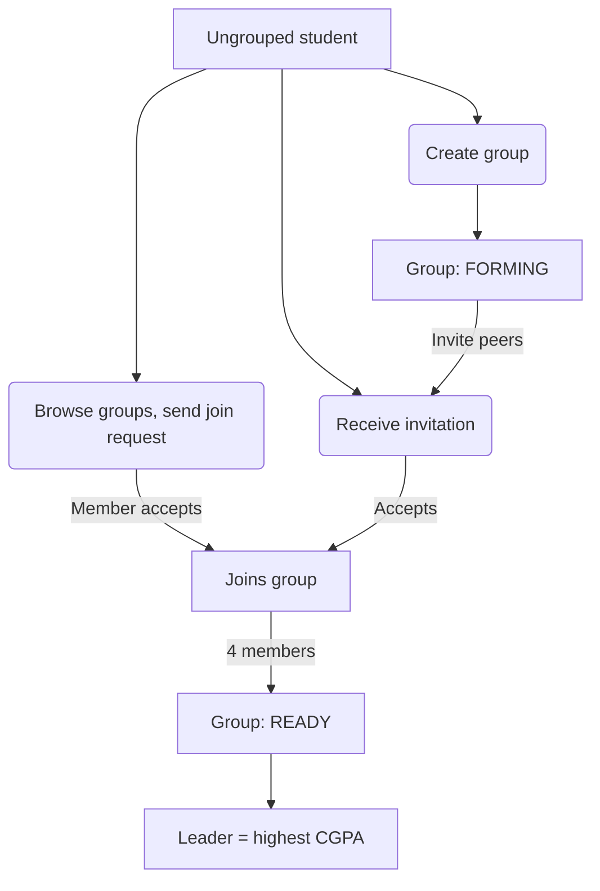
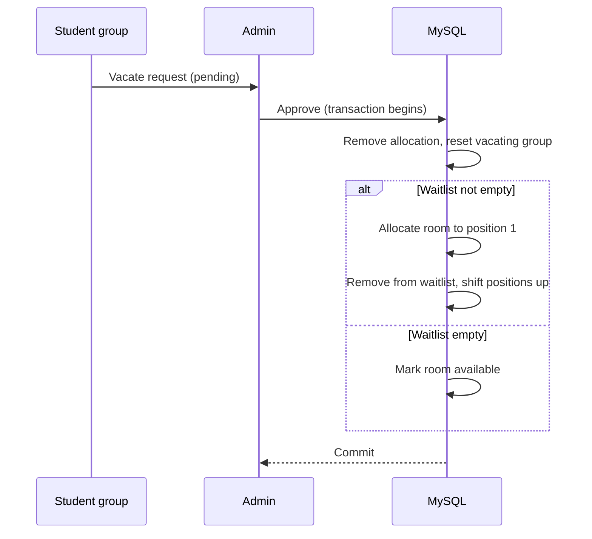

# 🏠 Smart Hostel Allocation & Room Management System

A full-stack DBMS project that automates hostel room allocation. Students form groups of four, submit ranked room preferences, and an admin runs a **CGPA-based allocation algorithm**. If a preferred room is taken, the group is placed on a waiting list and is promoted automatically when a room is vacated.

Everything is built on **hand-written, parameterized SQL** (no ORM) using `mysql2` with connection pooling, transactions, and row-level locking.

---

## ✨ Features

**Students**
- Register and log in (JWT authentication)
- Create a group, or browse open groups and send join requests
- Invite ungrouped students, and accept or reject invitations and requests
- Leave a group before allocation (the leader is re-elected automatically)
- Submit an ordered list of preferred rooms once the group has 4 members
- View allocation result or waiting-list position
- Raise a vacate request

**Admin**
- Dashboard with live statistics and an activity log
- Run the allocation algorithm
- **Merge & auto-allocate** leftover students into random groups of 4
- Approve or reject vacate requests (with automatic waitlist promotion)
- Data viewer for students, groups, rooms and the waiting list

---

## 🛠️ Tech Stack

| Layer | Technology |
| :-- | :-- |
| Frontend | React 19, Vite, React Router, Axios, Tailwind CSS v4 |
| Backend | Node.js, Express 5 |
| Database | MySQL 8+ (InnoDB), raw SQL via `mysql2/promise` with connection pooling |
| Security | JWT, bcrypt, helmet, CORS, express-rate-limit (login), express-validator |

---

## 📂 Project Structure

```
├── README.md
├── TEAM_WORK_DISTRIBUTION.md
├── student_accounts.md            # Generated list of test accounts
├── backend/
│   ├── database/
│   │   ├── schema.sql             # 12 tables, constraints, indexes
│   │   ├── setup.js               # Creates DB and runs schema.sql
│   │   ├── seed.js                # Admin user, hostels and rooms
│   │   ├── seed_test_data.js      # Sample students and groups
│   │   └── generate_credentials_md.js
│   ├── src/
│   │   ├── app.js / index.js
│   │   ├── config/db.js           # Pool + withTransaction helper
│   │   ├── middleware/            # auth, role, validation, error handling
│   │   ├── modules/               # routes → controller → service → repository
│   │   │   ├── auth/  groups/  rooms/  preferences/
│   │   │   └── allocations/  vacate/  admin/
│   │   └── utils/                 # AppError, jwt, asyncHandler
│   ├── .env.example
│   └── package.json
└── frontend/
    ├── src/
    │   ├── api/                   # Axios clients per module
    │   ├── components/            # common, admin, student
    │   ├── context/  hooks/  routes/
    │   └── pages/                 # auth, student, admin
    ├── .env.example
    └── package.json
```

---

## ⚡ Getting Started

### Prerequisites
- Node.js v18 or newer
- MySQL Server 8.0 or newer, running locally

### 1. Create the MySQL user
The default config expects a user `hostel` with password `root`:

```bash
sudo mysql -e "CREATE USER IF NOT EXISTS 'hostel'@'localhost' IDENTIFIED BY 'root'; GRANT ALL PRIVILEGES ON *.* TO 'hostel'@'localhost' WITH GRANT OPTION; FLUSH PRIVILEGES;"
```

> This is for local development only. Use a restricted user and a strong password anywhere else.

### 2. Backend

```bash
cd backend
npm install
cp .env.example .env        # edit values if needed
npm run db:setup            # creates hostel_db and all tables
npm run db:seed             # admin user + hostels and rooms
npm run db:seed:test        # optional: sample students and groups
npm run dev                 # http://localhost:5000
```

### 3. Frontend

```bash
cd frontend
npm install
cp .env.example .env
npm run dev                 # http://localhost:5173
```

### 4. Log in

| Role | Email | Password |
| :-- | :-- | :-- |
| Admin | `admin@hostel.com` | `admin1234` |
| Student (leader, preferences submitted) | `aarav.pawar.1@hostel.com` | `student123` |
| Student (ungrouped) | `maresh.thorat.83@hostel.com` | `student123` |

All seeded students use `student123`. The full list is in `student_accounts.md`.

> ⚠️ Change the seeded admin password and `JWT_SECRET` before any real deployment.

---

## ⚙️ Environment Variables

**`backend/.env`**

| Variable | Default | Description |
| :-- | :-- | :-- |
| `DB_HOST` | `localhost` | MySQL host |
| `DB_PORT` | `3306` | MySQL port |
| `DB_USER` | `hostel` | MySQL user |
| `DB_PASSWORD` | `root` | MySQL password |
| `DB_NAME` | `hostel_db` | Database name |
| `DATABASE_URL` | – | Optional single connection string |
| `JWT_SECRET` | – | Secret used to sign tokens |
| `PORT` | `5000` | API port |
| `CORS_ORIGIN` | `http://localhost:5173` | Allowed frontend origin |

**`frontend/.env`**

| Variable | Default |
| :-- | :-- |
| `VITE_API_URL` | `http://localhost:5000/api` |

---

## 🔄 How It Works

### 1. Group formation
Students need a group of **exactly 4** to be eligible for allocation.



- All members have equal permissions to invite and to handle requests.
- When a student joins, their other pending requests and invitations are removed.
- When a group reaches 4 members, it becomes `READY` and its remaining pending requests and invitations are purged.

### 2. Room preferences
A `READY` group submits an ordered list of rooms. Its status becomes `PREFERENCES_SUBMITTED`.

### 3. Allocation algorithm
Run by the admin, inside a single transaction:

1. Fetch all groups with `PREFERENCES_SUBMITTED`.
2. Sort by **leader CGPA (descending)**, then **group ID (ascending)** as a tie-breaker.
3. For each group, walk its preferences in order, locking rooms with `SELECT ... FOR UPDATE`.
4. The first available room is allocated (room → `allocated`, group → `ALLOCATED`).
5. If none are available, the group becomes `WAITING` and is appended to the waiting list.

### 4. Merge & auto-allocate
After standard allocation is complete, the admin can run a second pass. It disbands incomplete groups, shuffles the remaining ungrouped students into groups of 4, and allocates available rooms to them. It requires at least 4 ungrouped students and will not run while any group still has pending preferences.

### 5. Vacate & waitlist promotion



---

## 🗄️ Database Design

12 tables:

`students` · `groups` · `group_members` · `hostels` · `rooms` · `room_preferences` · `allocations` · `waiting_list` · `vacate_requests` · `join_requests` · `group_invitations` · `activity_log`

**DBMS concepts demonstrated**

- **ACID transactions:** allocation runs and vacate/promotion are wrapped in `beginTransaction` / `commit` / `rollback` through a `withTransaction` helper, so they either fully succeed or fully roll back.
- **Concurrency control:** `SELECT ... FOR UPDATE` row locks prevent two groups from being given the same room.
- **Normalization (3NF):** student details are separate from groups; membership is a junction table (`group_members`) with composite key `(groupId, studentId)`.
- **Constraints:**
  - `UNIQUE` on `students.email`, `groups.groupCode`, `(hostelId, roomNumber)`, `(groupId, preferenceOrder)` and `(groupId, roomId)`
  - `UNIQUE` on `allocations.groupId` and `allocations.roomId` (one room per group, one group per room)
  - `UNIQUE` on `waiting_list.groupId` and `position`
- **Foreign keys with cascades:** deleting a group or student cleans up dependent rows.
- **Indexes:** on `rooms.status`, `vacate_requests.status`, `join_requests.status` and `group_invitations.status`, plus the indexes implied by the unique keys.

---

## 🔌 API Overview

All routes are prefixed with `/api`. Most require a `Bearer` token; admin routes also require the `admin` role.

| Module | Endpoints |
| :-- | :-- |
| **Auth** `/auth` | `POST /register`, `POST /login`, `GET /me` |
| **Groups** `/groups` | `POST /` (create), `GET /my`, `DELETE /leave`, `GET /discover`, `GET /students-without-groups`, `GET /pending`, plus join-request and invitation send, respond and cancel routes |
| **Rooms** `/rooms` | `GET /` |
| **Preferences** `/preferences` | `POST /` (submit), `GET /my` |
| **Allocations** `/allocations` | `POST /run` *(admin)*, `POST /merge-allocate` *(admin)*, `GET /result` *(student)*, `GET /` *(admin)* |
| **Vacate** `/vacate-requests` | `POST /` (student), `GET /` *(admin)*, `PATCH /:id/approve` *(admin)*, `PATCH /:id/reject` *(admin)* |
| **Admin** `/admin` | `GET /students`, `/groups`, `/rooms`, `/waiting-list`, `/stats`, `/activity` |

---

## 👥 Team & Contributions

| Member | Domain | Tables | Backend | Frontend | Key DBMS concepts |
| :-- | :-- | :-- | :-- | :-- | :-- |
| **Aryan** | Authentication, security, admin analytics | `students`, `activity_log` | `modules/auth`, `modules/admin`, `config/db.js`, `middleware/*` | `LoginPage`, `RegisterPage`, `AdminDashboardPage`, `StatsCard` | JWT + bcrypt, RBAC, single-trip multi-subquery analytics, MySQL error-code mapping (1062 → 409, 1451/1452 → 400) |
| **Gayatr** | Hostel inventory, room preferences, DB scripts | `hostels`, `rooms`, `room_preferences` | `modules/rooms`, `modules/preferences`, `database/setup.js`, `seed.js`, `generate_credentials_md.js` | `RoomPreferencePage`, `DataViewerPage`, `RoomCard`, `RoomGrid`, `PreferenceList`, `DataTable` | Composite candidate keys, multi-table `LEFT JOIN`, priority-ordering constraints, atomic preference replacement |
| **Shrutika** | Group formation, invitations, leader election | `groups`, `group_members`, `join_requests`, `group_invitations` | `modules/groups` | `GroupPage` | M:N junction table with composite PK, cascading deletes, `NOT EXISTS` set inversion, CGPA-based leader re-election |
| **Vaibhav** | Allocation engine, vacate and waitlist | `allocations`, `waiting_list`, `vacate_requests` | `modules/allocations`, `modules/vacate`, `database/seed_test_data.js` | `AllocationResultPage`, `DashboardPage`, `RequestsPage` | ACID transactions, `SELECT ... FOR UPDATE` locking, positional waitlist shifting |

### Highlighted queries

**Dashboard stats in one round trip** (Aryan)
```sql
SELECT
  (SELECT COUNT(*) FROM students WHERE role = 'student') AS totalStudents,
  (SELECT COUNT(*) FROM `groups`) AS totalGroups,
  (SELECT COUNT(*) FROM rooms) AS totalRooms,
  (SELECT COUNT(*) FROM `groups` WHERE status = 'ALLOCATED') AS allocatedGroups,
  (SELECT COUNT(*) FROM `groups` WHERE status = 'WAITING') AS waitingGroups;
```

**Leader re-election when a member leaves** (Shrutika)
```sql
SELECT gm.studentId, s.cgpa
FROM group_members gm
INNER JOIN students s ON gm.studentId = s.id
WHERE gm.groupId = ?
ORDER BY s.cgpa DESC, gm.studentId ASC
LIMIT 1;
```

**Ungrouped students via `NOT EXISTS`** (Shrutika)
```sql
SELECT s.* FROM students s
WHERE s.role = 'student'
  AND NOT EXISTS (SELECT 1 FROM group_members gm WHERE gm.studentId = s.id);
```

**Row lock during allocation** (Vaibhav)
```sql
SELECT id, roomNumber, status FROM rooms WHERE id = ? FOR UPDATE;
```

**Waitlist shift after promotion** (Vaibhav)
```sql
UPDATE waiting_list SET position = position - 1 WHERE position > ?;
```

---

## 🤝 Contributing

Each member works on a feature branch and opens a pull request into `main`.

```bash
git checkout main && git pull origin main
git checkout -b feature/<short-name>
git add <your files>
git commit -m "feat(<scope>): <description>"
git push -u origin feature/<short-name>
```

Branches used: `feature/auth-security-admin`, `feature/rooms-preferences-inventory`, `feature/group-formation-members`, `feature/allocation-engine-vacate`.

**Ground rules**
1. Never commit `.env` files or `node_modules`.
2. Don't rename keys in API JSON responses. The frontend depends on them (e.g. `totalStudents`, `allocatedGroups`, `groupCode`, `cgpa`).
3. Always use parameterized queries (`WHERE id = ?`). Never concatenate values into SQL.
4. Wrap `groups` in backticks in SQL, because it is a reserved word in MySQL 8.
5. Run `node -c <file.js>` and confirm `npm run dev` starts cleanly before pushing.

---

## 🎓 Viva Quick Reference

- **Why raw SQL instead of an ORM?** It shows direct control over transactions, locking, query design and MySQL error codes.
- **Why InnoDB?** It supports ACID transactions, foreign keys with cascades, and row-level locking. MyISAM supports none of these.
- **How are double allocations prevented?** Allocation runs in one transaction, and each candidate room is read with `FOR UPDATE`. Unique keys on `allocations.roomId` and `allocations.groupId` back this up at the schema level.
- **How is the waitlist promoted?** In one transaction: delete the allocation, take the group at position 1, allocate the room, remove it from the waitlist, then shift the remaining positions.
- **How are duplicate emails handled?** A `UNIQUE` constraint on `students.email`, with errno 1062 mapped to HTTP 409.

---

## 📜 Scripts

| Command | Location | Purpose |
| :-- | :-- | :-- |
| `npm run dev` | backend | Start API with nodemon |
| `npm start` | backend | Start API with node |
| `npm run db:setup` | backend | Create database and tables |
| `npm run db:seed` | backend | Seed admin, hostels, rooms |
| `npm run db:seed:test` | backend | Seed sample students and groups |
| `npm run dev` | frontend | Start Vite dev server |
| `npm run build` | frontend | Production build |
| `npm run lint` | frontend | Run oxlint |
